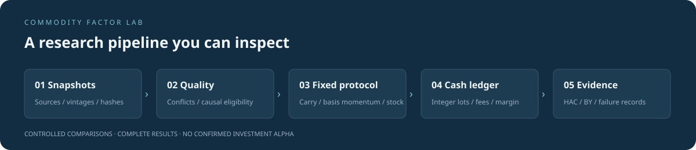
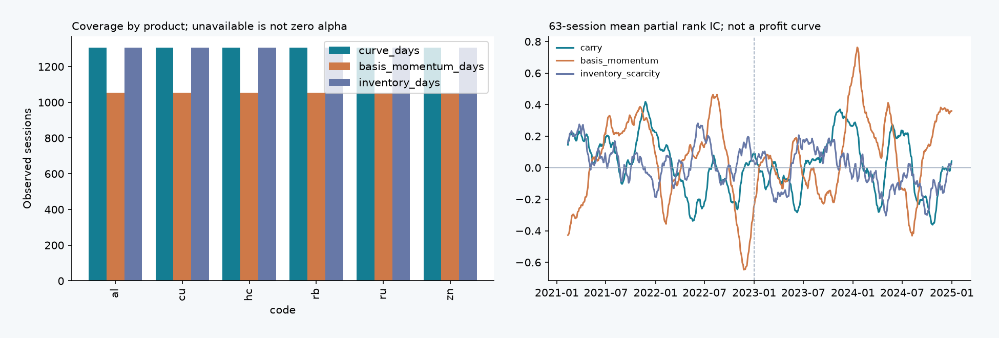
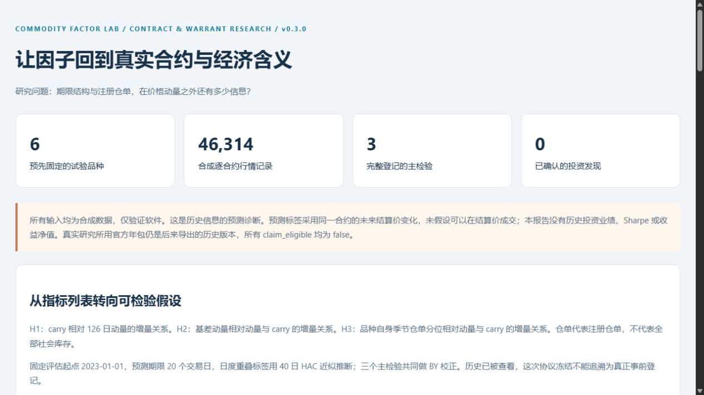

<div align="center">

# Commodity Factor Lab

**中国商品期货：多类因子复核、增量预测与交易模拟**

从真实合约、信息时点和现金账开始，让研究可以被复核和推翻。

`Python 3.11+` · `Contract-level data` · `HAC + BY` · `Offline demo`

[阶段结论](docs/final/REPORT.md) · [因子覆盖](docs/final/FACTORS.md) · [研究摘要](docs/final/ABSTRACT.md) · [复现说明](docs/final/REPRODUCE.md) · [交付说明](docs/final/RELEASE.md) · [运行演示](#快速运行) · [研究协议](docs/research_charter.md) · [方法](docs/contract_methodology.md) · [数据就绪度](docs/source_readiness.md) · [文献](docs/literature.md) · [任务进度](docs/task_status.md)

</div>



**本阶段交付（2026-11-01）**：以本目录 v0.17 代码与[阶段结论](docs/final/REPORT.md)为权威源；研究副本中的新协议未冻结，S1、E、S2 未实施。现有历史可以交付，仓单仍为“有线索、未确认”。先读[复现范围与命令](docs/final/REPRODUCE.md)、[727/674/48/20 与拟议 24 项的数字口径](docs/final/NUMBERS.md)和[对外介绍](docs/final/SUMMARY.md)。公开包不含行情、本机运行输出、协作记录或未冻结草案，克隆不能直接复算真实研究。

本轮完成七类26个旧指标的去留审查，并实际检验 carry、基差动量、仓单、相对基差、规范化持仓变化及工业品参考信息；动量为主要基准，真实现货基差因来源与匹配不足未进入新增预测检验。详见[全部因子覆盖](docs/final/FACTORS.md)。26个旧指标和20项已知探索均不等于同样数量的独立因子已获验证。历史阶段本地收尾，远程仓库与许可尚未发布。

本项目起源于一份商品期货因子研究。复核发现原业绩、因子命名、连续合约计量和统计推断存在不足，不能支持原结论；相关主张已登记[撤回](configs/retired_claims.toml)，原始材料留作研究档案。

v0.3 将研究问题收窄为：**期限结构与注册仓单，在价格动量之外是否具有增量预测信息？** 首轮使用上期所铜、铝、锌、螺纹钢、热卷、天然橡胶六品种，2020–2025 年历史，2023 年起评估。六个相关品种是方法试验，不能代表全部商品市场。

## 当前进展 v0.17

完成[共同样本效应与不确定性](docs/factor_evidence_results.md)：三个候选统一使用674个有效日期、8—9品种。仓单平均增量秩相关约0.105，但主方法本轮同时区间约[−0.012, 0.222]，仍不能确认；carry和基差动量也没有稳健增量证据。三个候选的区间都太宽，不能把“未确认有效”写成“证明无效”。完整保留时间处理敏感性及分辨率诊断。

原不同样本诊断复现，新三个问题计入探索17→20。没有新增投资收益或独立确认。[交易经济价值协议及缺价估值规则](docs/research_direction.md)保留为后续研究，当前历史以完整负结果与未决结果交付；本阶段见[展示摘要](docs/final/SUMMARY.md)。

## 容量与执行 v0.16

已修复部分品种失格后遗留旧持仓的问题，原4,380条目标及三个原主情景资金账全部复现。新增[容量与延迟执行研究](docs/capacity_results.md)：按过去20交易日成交量的1%/5%限制调整量，未完成目标分日执行，旧约平完再开新约。1%情景有期末残仓，混合路径遇缺少必要开盘记录而中止；5%情景三本完成，混合仍落后动量约13.57个百分点。没有选择较好的参与率或宣称实际成交已认证。

已登记探索增至17项，当前仍无确认的新因子或可交易Alpha。此前“整体约72%”估计已撤回，改按[验收状态](docs/task_status.md)跟踪。下一重点是收敛原研究问题、统一风险预算并完成不确定性评价。

## 原组合归因 v0.15

已对原资金账做[盈亏与风险拆解](docs/market_attribution_results.md)：混合落后主要来自白银/黄金少赚、纸浆亏损增加；约94%的净差来自毛盈亏，额外摩擦约6%。混合平均最大目标权重由18%升到22.63%，目标更集中；历史波动/回撤较小不能直接读成分散化更好。原订单和16项探索登记保持，无新增策略或确认性结论。[固定拆解口径](docs/market_attribution_methodology.md)及全部品种、年份、风险/费用贡献可复核。

## 固定市场基准 v0.14

已把“加入期限结构能否改善动量”落到逐合约、整数目标、换月双腿和逐日结算资金账。固定主情景（单边总摩擦5bp、保证金20%、假设记录开盘全量成交）中，2023—2025动量累计模拟收益23.02%，50/50混合10.09%，落后12.93个百分点；混合回撤稍小。**当前混合用法不进入核心策略，未确认可交易Alpha。** 完整[结果](docs/market_benchmark_results.md)与[预先冻结方法](docs/market_benchmark_methodology.md)分别保留。

3组合×4成本×2保证金×2成交假设全部报告。历史已看过，时钟为事件顺序占位，费用/保证金为明确回溯假设；不能写成真实成交业绩或独立样本验证。新增一个描述性研究问题，探索族15→16；数据库和完整看板暂缓。

<details>
<summary>历史阶段与原始结果</summary>

## 旧规则与竞价截止 v0.13

找到2024年旧版规则，可解释铜2503在春节后仍需10%保证金，远月铜2504仍为9%也与规则组件相符；两个恢复情景与观察参照分别保留，未认证初发版本或全部通知覆盖。资金账新增竞价申报截止，拒绝已过申报截止但仍早于09:00的决策，避免直接赋予开盘价。194项测试、887项独立核对通过，四个原合成账本原字段仍零差异。**没有新增有效因子或真实投资收益。** 详见[历史规则与竞价截止](docs/execution_rule_review_results.md)。

## 执行来源 v0.12

取得三份有日期的交易所通知、一个现行时段负对照及十二份参数快照，核对合约/月份手续费与同日交易、结算保证金。已修复资金账只能使用同日单一保证金比例的限制：开盘预算、结算占用及参数可用时钟分开校验。四个原合成账本旧字段全部复现，新增手算例子验证结算增保后下一开盘减仓。182项测试通过、355项独立核对零差异；**没有新增预测检验或真实投资收益**。真实初发、经纪收费及实际开盘/成交仍须认证。详见[执行来源与两阶段保证金](docs/execution_readiness_results.md)。

## 参考信息预测 v0.11

完成已发布工业品参考信息首轮时间序列预测诊断：固定单一参考价变化信号、期货信息对照、目标成熟后才训练和训练内标准化。2023—2025年97次公告、555个品种事件中，加入参考信息使平方预测误差增加1.89%，也输给历史均值和零预测，**暂不纳入核心策略**。本轮无正式p值或投资收益；探索登记14→15。169项测试通过，76,458项独立程序核对零差异。详见[预测结果](docs/nbs_prediction_results.md)与[固定方法](docs/nbs_prediction_methodology.md)。

## 六年参考历史 v0.10

已建成2020—2025固定范围的官方工业品参考历史：216个日历期次全部交代，210份原文、6个有证据的取消期，10,500条价格与10,500条规格。原池七品种有1,222条相关参考，11次元数据身份变化分段保留；209次公告可对齐原行情日历，2026年公布的末期不填回2025年。本轮154项测试通过，64,485项独立核对零差异，**未新增预测检验或投资收益**。详见[六年参考价格历史](docs/nbs_history_results.md)。

## 工业品来源小样本 v0.9

已跑通国家统计局工业品参考数据：八份固定旬报、400条价格与400条规格，原池七个品种有相关参考；原表、规格、发布时间及事件对齐经2,060项独立检查，零差异。五个URL日期与正文时钟不同，程序按正文时间对齐；春节缺期和规格变化保持分开。**这条来源值得扩采并另立工业品价格信息研究，本轮没有新增预测检验。** 详见[工业品参考数据接入](docs/industrial_reference_results.md)。

## 实物现货小样本 v0.8

完成官方真实现货的小样本准入：十二个固定日期中，两种黄金报价各十一日有成交，白银七日，共二十九条同日期逐合约价格比较；春节空表、缺行及零成交保留缺失。**最多只有黄金、白银两个品种，历史发布和实物/税务匹配仍未认证，暂不激活现货基差**。本轮没有新增预测检验，十四项探索族不变；方法、来源和缺口见[现货准入结果](docs/spot_results.md)。

## 历史版本复核 v0.7

追查历史版本并改进历史窗口的信息集规则：原 44 异常日期未找到可认证初发版本；允许已达到来源标注时钟的历史记录用于后续信号，原 5,034 个合格信号数值不变，新增 368 个后续窗口。有效日期由 433 增至 469，p≈0.101、十四项探索 q≈0.917，仍未通过检验。镜像、文件时钟及 HTTP 修改时间不能证明首次发布，详情见[历史版本复核](docs/vintage_review.md)。

## 完整持仓采集 v0.6

完成 747 个交易日期的官方排名采集、同合约二十日榜单持仓变化，以及 **110,721 项独立核对，零差异**。433 个日期满足固定增量检验，平均部分秩相关约 0.075、p≈0.086、十三项已登记探索 q≈0.894，仍未通过检验。另发现 44 个历史日期的当前文件更新时间晚于既定截止，保守排除，未假定它们当时可用。完整结果、年度覆盖及版本问题见[持仓研究结果](docs/position_results.md)。

## 全量因子审查 v0.5

完成全部 **七类、26 个旧指标**的逐项审查：12 项重建、6 项并入价格信号族、5 项撤出收益检验、3 项仅用于风险。旧“价值”在可比行全部等于历史价格涨幅，已纠正命名。新增相对基差在动量、carry、基差动量之外的平均部分秩相关为 0.0215、p≈0.528，未形成稳健证据；持仓及匹配现货基差继续等待合格输入。完整决定、缺失案例和失败结果见[其他因子复核](docs/other_factor_results.md)。

## 原始对账与扩样 v0.4

完成 **91,750 项原始记录及独立算术对账，核对范围内零差异**；依据评估前覆盖规则从十八个候选扩至十品种、169,562 行。仓单出现正向线索，但计入已登记九项探索后 q≈0.399，仍未确认有效。完整规则、首次对账器修正、排除原因和结果见[对账与扩样](docs/validation_results.md)。原六品种结果保持可追溯，没有按扩样结果重选公式或方向。

</details>

## 快速运行

推荐 Python 3.12，在项目根目录执行：

```bash
python -m venv .venv
```

Windows PowerShell：

```powershell
.\.venv\Scripts\Activate.ps1
python -m pip install -e ".[dev]"
python -m commodity_factor_lab contract-demo
```

macOS / Linux：

```bash
source .venv/bin/activate
python -m pip install -e '.[dev]'
python -m commodity_factor_lab contract-demo
```

打开输出目录中的 `index.html`，并进入“合成交易账验证”查看明细。短命令为 `cfl contract-demo`。首次安装后演示可离线运行，不需要账号、数据库、密钥或真实行情。

**演示的行情、仓单、参数及交易时段全部是合成数据，盈亏只用于验证程序。** 整数手数订单以信号日已知结算价定规模，随后执行逐日结算、开平仓收费、双腿换月和保证金占用。



<details>
<summary>查看报告界面</summary>



</details>

## 因子结构与评价

| 角色 | 定义与用途 |
|---|---|
| 基准 | 126 日动量：昨日已选合约的同合约收益链，避免换月价差伪造收益 |
| H1 | carry：近、次近月对数价格比除以真实到期年差，正值为近月溢价；控制动量 |
| H2 | 基差动量：252 日近、次近月收益链累计收益之差；控制动量与 carry |
| H3 | 仓单稀缺：品种自身过去季节的注册仓库仓单分位；控制动量与 carry |
| 探索 | 相对基差的简单曲线斜率差代理，未声称完整复现论文 |
| 持仓探索 | 规范化 Top20 榜单净持仓变化：连续同合约、发布时间及单边 OI 校验；本轮未通过检验 |
| 参考信息诊断 | 同口径相邻旬参考价变化，分品种递推预测；首轮误差未改善，保留负结果 |
| 风险及后续 | 波动只作风险描述；匹配现货基差仍等待合格输入 |

原主检验先对截面秩残差化，再计算部分秩相关；未来标签固定为信号选定合约从下一日结算至再后 20 个交易日结算的变化。日度标签重叠，采用 40 日 HAC 近似推断，三项主检验共同做 BY 校正；不足项也占校正族名额。新增参考信息实验采用各品种时间序列，完整给出递推预测误差，不套用上述截面门槛或显著性方法。**预测关系不是结算价成交收益，也不是投资 Alpha。**

选约使用截止时已出现的真实到期日，固定 60–540 自然日、成交量和持仓门槛；不按未来标签完整性决定当时资格。仓单至少三年季节历史，按发布时间使用修订版本，过期或短历史保持缺失，不跨品种比较原始吨数。

原有 26 个指标和 v0.2 连续价格复核保留为历史与兼容接口，当前主入口为 `contract-research` / `contract-demo`。完整定义可用 `cfl factors` 导出。

## 真实数据与证据状态

当前十品种六年官方逐合约日行情共 **169,562 行、1,455 个观测交易日期**；其中原六品种101,850行。72次逐月合约参数全部可解析。仓单计划308个周采样日期，尝试306次、301次成功、5次失败、2次未查询；成功样本截至2025-11-14。旧、新字段结构分别验证，仓库与厂库不混加。

官方来源仍不足以自动认证历史信息集：年包可能经过修订，月度参数可能漏掉月中变更，20:30 信息截止是回溯假设。部分历史费用、保证金文件含更晚更新时间；新仓单页面只有日期，不能凭空填发布时间。具体样本、地址与处理见[数据就绪度](docs/source_readiness.md)。

当前没有可确认的投资发现。历次结果见[六品种](docs/contract_results.md)、[十品种扩样](docs/validation_results.md)、[新增候选](docs/other_factor_results.md)和[持仓](docs/position_results.md)。到期缓冲曾由 30 日修订为 60 日，旧版本已留存；历史已被查看，当前 BY 校正不能覆盖所有此前探索，全部 `claim_eligible=false`。

真实交易账组件已经实现，**真实历史投资验证仍需合格的时段、费用、保证金和成交条件输入**。程序没有把日成交量大于零当成可成交证明，也没有将合成演示包装成市场业绩。

## 复核与扩展

```bash
# 完全离线的逐合约研究和现金结算演示
cfl contract-demo

# 完全人工的开盘/结算保证金变更例子（输出目录必须不存在）
python scripts/demo_margin_phases.py --output reports/demo_margin_phases

# 原六品种固定协议复核
cfl contract-research --config configs/curve_pilot.toml

# 覆盖规则筛选后的十品种稳健性研究
cfl contract-research --config configs/curve_expanded.toml

# 固定工业品参考信息预测诊断（需配置所列本地真实输入）
cfl nbs-prediction --config configs/nbs_prediction.toml

# 独立运行严格现金账，输入规范见合约数据文档
cfl execution-ledger --bars data/market/execution.csv --calendar data/market/calendar.csv --orders data/market/orders.csv --output reports/ledger/example

# 历史连续价格复核兼容入口
cfl study-demo
```

公开仓库不分发原始行情，克隆后不能直接运行本机真实研究配置。获取官方年包、合约参数和仓单的命令与格式见[数据接口](data/README.md)、[合约输入](docs/contract_data.md)。每次运行创建新目录，记录输入、协议、源码哈希、完整主检验、失效标签、年度及留一品种诊断。

```text
src/commodity_factor_lab/   当前研究包与 CLI
configs/                   研究协议、历史版本与撤回登记
tests/                     时点、标签、换月、费用、现金与统计检验
docs/                      研究方法、数据边界、文献和重建记录
data/                      本地原始快照、官方版本和合成数据（不公开）
reports/                   本地结果与审计（不公开）
research/legacy/           原研究程序，仅供溯源
private/                   原论文与个人材料（不公开）
scripts/                   迁移校验、版本审计与发布打包
```

## 开发与发布

```bash
python -m unittest discover -s tests -v
ruff check src tests scripts
python -m build
python scripts/package_public.py
```

CI 配置覆盖 Windows/Linux、Python 3.11/3.12，运行测试与离线演示；本机验证环境为 Python 3.12，其他环境须以实际 CI 结果为准。HAC 另与 statsmodels 交叉核对。

[研究路线](docs/roadmap.md)按证据依赖推进。[公开源码包](docs/publishing.md)采用白名单，不包含行情、论文、个人信息或本地结果；尚未选择许可证或上传远程仓库。当前可以展示研究审计、可追溯实验和工程能力，不能宣传已经获得可交易 Alpha。
